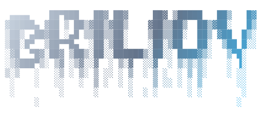

<p align="center">
  
</p>

<h1 align="center">Banner Builder</h1>

<p align="center">
  Offline-first CLI tool for generating multi-stop RGB gradient <b>SVG banners</b> and true-color <b>Zsh greetings</b> via local <code>FIGlet</code>.
</p>

---

## Why Use It

* **Zero external SVG services** — renders crisp vector `<tspan>` graphics locally in milliseconds.
* **Dual output** — builds `banner.svg` for GitHub and `banner.zsh` for your terminal in one shot.
* **Unlimited gradient stops** — pass any number of HEX colors and save favorite palettes to `presets.json`.
* **Built-in font manager** — browse installed fonts or pull new `.flf` styles straight from `xero/figlet-fonts`.

---

## Two Ways to Run

### 1. Hub Mode (GitHub Profile Assets)
Connect the builder to your Zsh environment so `set-banner` updates `assets/banner/` from any directory.

```bash
./builders/banner/install.sh
source ~/.zshrc
set-banner -t "BRILIOV" -f ansi_shadow -p steel
```

> **Tip:** Preview your terminal greeting anytime with `zsh "$BANNER_OUT_DIR/banner.zsh"` or source it at the bottom of `~/.zshrc`.

### 2. Standalone Mode (Any Project)
Run the script independently without touching profile assets — save output into any target folder via `-o`.

```bash
python3 builders/banner/build.py -t "MY API" -f slant -p cyber -o ./docs/img
```

---

## Built-in Color Presets

Stored in `builders/banner/presets.json` (extendable via `--save-preset <name>`):

| Preset | Palette Stops | Vibe |
| :--- | :--- | :--- |
| `steel` | `#cbd5e1` → `#64748b` → `#38bdf8` | Cold metallic blue *(default)* |
| `fire` | `#ff0000` → `#ff5f00` → `#ffaf00` → `#ffd700` | Warm ember gradient |
| `cyber` | `#9d00ff` → `#ff007f` → `#00f0ff` | Synthwave neon |
| `emerald` | `#00875f` → `#00d787` → `#afff00` | Matrix / terminal green |
| `ocean` | `#0033ff` → `#0099ff` → `#00ffff` | Deep electric blue |
| `mono` | `#585858` → `#9e9e9e` → `#ffffff` | Minimalist grayscale |

---

## Recipes & CLI Flags

```bash
# Create a custom 4-stop gradient with outer padding and save it as a preset
set-banner -c '#ffffff,#bae6fd,#38bdf8,#1d4ed8' --pad 2 --save-preset ice

# Re-color existing banner.txt with a vertical flow
set-banner -p ice -d vertical

# List installed/remote fonts or install a new one
set-banner -l
set-banner -l install "ANSI Shadow"
```

| Flag | Default | Description |
| :--- | :--- | :--- |
| `-t, --text` | *cached* | Text to render via `figlet` (reuses `banner.txt` if omitted). |
| `-f, --font` | `standard` | Local FIGlet font name. |
| `-p, --preset` | `steel` | Theme name from `presets.json`. |
| `-c, --colors` | — | Custom HEX stops separated by comma or space. |
| `--save-preset` | — | Save current colors into `presets.json`. |
| `-d, --direction` | `diagonal` | Gradient flow: `horizontal`, `vertical`, `diagonal`. |
| `-s, --size` | `16` | SVG font size in pixels. |
| `--pad` | `1` | Uniform padding around banner (Zsh lines/spaces & SVG margins). |
| `-o, --out` | `$BANNER_OUT_DIR` | Output directory (falls back to current working dir). |
| `-l, --list-fonts` | — | Show fonts or install via `-l install <FONT>`. |
